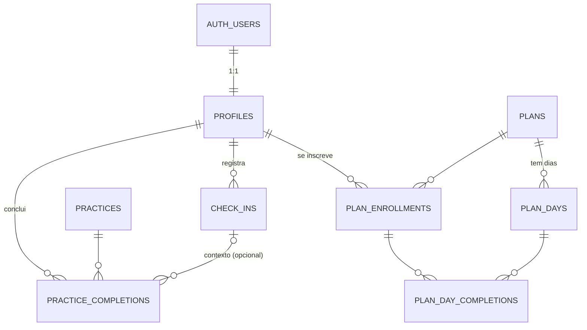

# Registro técnico — CLAVIS VIA

Respostas objetivas às perguntas do desafio. Detalhes de execução estão no [README](README.md).

---

## 1. Arquitetura: por que essa stack e como as partes se comunicam?

**Stack:** Next.js 16 (App Router) + Supabase (Postgres + Auth) + Vercel.

- **Um único projeto para front e back.** React Server Components renderizam as telas no servidor e as Server Actions fazem as escritas. Não há uma API REST própria para manter, versionar e documentar só para servir uma interface.
- **Supabase** entrega Postgres de verdade (constraints, triggers, transações), Auth com login anônimo e **Row Level Security**. A segurança fica no banco, não só no código da aplicação.
- **Vercel + Supabase na mesma região (São Paulo, `gru1`)**: baixa latência entre função e banco, deploy a cada push e preview por PR. O banco foi provisionado pelo Marketplace da Vercel, então as variáveis de ambiente são sincronizadas sem copiar segredos à mão.

**Fluxo de uma requisição:**

```
Navegador ──(GET / POST Server Action, cookie httpOnly)──▶ Next.js (Vercel)
   proxy.ts          → renova o token da sessão e redireciona quem não tem sessão
   DAL (lib/dal)     → getClaims() valida o JWT; toda leitura passa por aqui
   supabase-js       → chama a Data API do Supabase com o JWT do PRÓPRIO usuário
Postgres             → aplica RLS (auth.uid()) + GRANTs por coluna + CHECKs + triggers
```

- O navegador nunca conversa direto com o banco. Mesmo que conversasse, a chave publicável só permite o que o RLS deixa.
- O app **não usa** a chave secreta (service role). Não existe caminho no código que ignore o RLS.
- A validação existe em três camadas: Zod no formulário (feedback imediato), Zod na Server Action (fonte da verdade) e `CHECK`/trigger no banco (última linha de defesa).
- Regras de negócio (recomendação, progresso, datas) ficam em funções puras em `lib/domain`, testadas sem banco nem framework.

**Escolhas conscientes dentro da stack**
- **Cache Components desligado.** Todas as telas dependem do usuário logado, então renderizar dinamicamente é mais simples de explicar e evita cache de dado pessoal por engano.
- **Transições de rota com `<ViewTransition>` do React 19.3**, nativo do App Router (sem biblioteca de roteamento animado). **GSAP** cuida da coreografia (títulos por linha, chave desenhada, respiração guiada) e **Motion** dos estados da interface (erros, seleção, toasts, layout).

## 2. Modelagem: entidades, usuários, check-ins e evolução nos planos



| Tabela | Papel |
|---|---|
| `auth.users` (Supabase) | Identidade. Hoje é um usuário **anônimo** por navegador; no futuro, contas com e-mail |
| `profiles` | Dados do app sobre a pessoa (nome de exibição), 1:1 com `auth.users`, com `on delete cascade` |
| `check_ins` | Emoção (`enum`) + nota opcional (≤ 280) + data. `CHECK`: "outro" exige descrição |
| `practices` | Conteúdo: prática, "chave do dia", passos, ritmo de respiração e **para quais emoções** é indicada |
| `plans` / `plan_days` | Conteúdo dos planos e de cada dia (mensagem, ação, pergunta de reflexão) |
| `plan_enrollments` | Pessoa × plano (quando começou). PK composta `(user_id, plan_id)` |
| `plan_day_completions` | Dia concluído + reflexão (≤ 1000). `unique (user_id, plan_day_id)` |
| `practice_completions` | Prática feita, opcionalmente ligada ao check-in que a motivou |

**Decisões de modelagem**
- **Diferentes usuários:** todas as linhas pessoais têm `user_id` com default `auth.uid()`, preenchido pelo banco e nunca pelo cliente (sem GRANT de INSERT nessa coluna). O RLS restringe SELECT e DELETE ao dono.
- **Evolução nos planos:** o progresso **não é um contador salvo**. Ele é derivado das conclusões (`computePlanProgress`), então não há como ficar inconsistente.
- **Integridade no banco:**
  - A FK composta `(plan_day_id, plan_id) → plan_days(id, plan_id)` impede marcar um dia de outro plano.
  - A FK `(user_id, plan_id) → plan_enrollments` exige inscrição.
  - Um trigger impede concluir o dia N sem o dia N-1.
  - O `unique` torna a conclusão idempotente: o duplo clique vira sucesso, não duplicata.
- **Conteúdo no banco, versionado em migration idempotente:** os planos precisam de FK com o progresso, e o conteúdo pode migrar para um CMS/admin depois sem mudar o modelo.
- **Datas:** gravadas em `timestamptz` (UTC). O "hoje" é calculado no fuso de São Paulo, porque um check-in às 23h30 não pode cair no dia seguinte.

## 3. Segurança: o que mudaria para dados emocionais reais (LGPD)?

Emoções e notas sobre o estado mental podem ser **dado pessoal sensível referente à saúde** (LGPD, art. 5º, II, e art. 11). Exigem base legal específica e cuidado redobrado.

**O que já está no protótipo**
- RLS em todas as tabelas, papel sem sessão sem acesso e GRANTs mínimos por coluna, **testados** com dois usuários reais (`tests/integration/rls.test.ts`).
- Encontrado e corrigido durante o deploy: o projeto na nuvem concedia `ALL` a `anon`/`authenticated` por padrão. A migration `harden_grants` revoga e reconcede só o necessário.
- Sessão em cookie httpOnly, JWT validado com `getClaims()` em toda leitura e action, nenhuma chave secreta no app nem no repositório.
- Headers de segurança (`X-Frame-Options`, `nosniff`, `Referrer-Policy`, `Permissions-Policy`), dados na região de São Paulo e só dados fictícios.

**O que eu mudaria para produção**
1. **Contas reais**: login por e-mail com código (OTP/magic link) e MFA opcional. O visitante anônimo pode ser convertido em conta sem perder dados (`updateUser`/`linkIdentity` da Supabase). CAPTCHA (Turnstile) no cadastro e no login anônimo, e expiração de sessão mais curta.
2. **Consentimento**: aceite **específico e destacado** para dados de saúde (art. 11, I), separado dos termos de uso, com registro de versão, data e revogação. Política de privacidade clara e encarregado (DPO) nomeado.
3. **Direitos do titular**: exportar meus dados (portabilidade, JSON) e excluir minha conta com apagamento em cascata (já modelado com `on delete cascade`), mais remoção de backups dentro da política de retenção.
4. **Minimização e retenção**: coletar só o necessário, apagar visitantes anônimos inativos após N dias (job agendado) e prazo definido para notas.
5. **Criptografia além do padrão**: o Supabase já cifra em repouso (AES-256) e em trânsito (TLS). Para as **notas livres**, criptografia em nível de aplicação (envelope encryption com chave em KMS), para que nem um operador do banco leia o texto.
6. **Logs sem dado sensível**: nada de emoção ou nota em logs, analytics ou mensagens de erro. Auditoria de acessos administrativos.
7. **Operadores e transferência**: DPA com Supabase e Vercel, cláusulas para transferência internacional quando houver, e plano de resposta a incidentes com comunicação à ANPD e aos titulares.
8. **Processo**: revisão de segurança, pentest antes do lançamento, dependências fixadas (lockfile) com atualização monitorada e acesso ao painel com MFA e menor privilégio.

## 4. Operação: deploy, observabilidade e recuperação

**Deploy**
- Vercel integrada ao GitHub: preview por PR, produção a cada merge na `main`. O CI (GitHub Actions) roda tipos, lint, unitários, integração de RLS e E2E contra um Supabase local em Docker, igual ao de produção.
- **Migrations** versionadas em `supabase/migrations`, aplicadas com `supabase db push` num job de deploy com aprovação manual (GitHub Environments). Migrations sempre aditivas e compatíveis com a versão anterior do código (expand → migrate → contract).

**Observabilidade**
- **Erros**: Sentry (front e server) com scrubbing de dado pessoal. Hoje as actions já registram o erro técnico no log do servidor e mostram uma mensagem amigável na tela.
- **Logs e métricas**: Vercel Observability (latência, erros por rota, funções) e logs do Supabase (Postgres, Auth, API) com alertas de erro 5xx e de latência.
- **Uptime**: `GET /api/health` (já existe) monitorado por um serviço externo (Better Stack/Checkly) a cada minuto, com alerta no celular/Slack.
- **Produto**: funil check-in → prática → dia concluído, com consentimento e sem conteúdo sensível.

**Recuperação de um serviço que parou**
1. **App** (deploy ruim): *Instant Rollback* da Vercel para o último deploy saudável, sem novo build. Depois, correção com teste que reproduz o problema.
2. **Banco**: backups diários e **PITR** (no plano Pro), restauração para um ponto antes do incidente. Migrations destrutivas só com backup verificado.
3. **Dependência fora (Supabase/Vercel)**: a página de status e o health check confirmam o problema, e a interface mostra uma mensagem amigável (as telas já têm estado de erro com "tentar novamente").
4. **Runbook** curto: quem é acionado, como diagnosticar (health → logs → status dos provedores), como reverter e como comunicar.

> Observação: o plano Free da Supabase pausa projetos inativos. Para uso real: plano Pro (PITR, sem pausa, suporte).

## 5. Evolução: 3 prioridades para uma primeira versão com clientes

1. **Contas e privacidade de verdade**: login por e-mail/OTP, conversão do visitante em conta sem perda de dados, consentimento LGPD, exportar e excluir dados. Sem isso não dá para ter clientes reais.
2. **Conteúdo e hábito**: um painel editorial simples (ou CMS) para a equipe publicar práticas e planos com revisão de profissionais, além de lembretes diários (PWA com push) e um histórico de emoções mais rico (padrões da semana, práticas que mais ajudaram). É isso que faz a pessoa voltar.
3. **Base operacional**: observabilidade (Sentry, alertas, uptime), analytics de produto com consentimento (ativação, retenção D1/D7, conclusão de planos), Supabase Pro com PITR, acessibilidade auditada e testes rodando em cada PR.

## 6. Integrações: IA com segurança e assinatura via Kiwify

**IA (ex.: conversa de acolhimento)**
- **Só no servidor**: route handler/Server Action chamando o modelo via AI SDK + AI Gateway da Vercel. Chaves só em variáveis de ambiente do servidor, nunca no navegador nem no repositório.
- **Mínimo de dados**: enviar só o necessário (emoção e mensagem atual), sem nome nem identificadores, com provedores em *zero data retention*. Histórico resumido e controlado pelo usuário.
- **Guardrails**:
  - Instruções de sistema que proíbem diagnóstico, prescrição e promessa de cura.
  - Detecção de sinais de crise, que interrompe a conversa e mostra ajuda humana (CVV 188, SAMU 192).
  - Moderação de entrada e saída e limite de uso por usuário.
- **Transparência**: rótulo claro de "resposta gerada por IA, não é aconselhamento profissional", consentimento específico para usar IA e opção de não usar.
- **Qualidade**: conjunto de conversas de teste (evals) com casos sensíveis rodando no CI antes de trocar prompt ou modelo.

**Assinatura via Kiwify (webhooks + controle de acesso)**
1. **Endpoint de webhook** (`/api/webhooks/kiwify`):
   - Valida a autenticidade conforme a documentação da Kiwify (token ou assinatura do payload) e recusa o que não validar.
   - Responde rápido e enfileira o processamento (Vercel Queues ou tabela de eventos).
2. **Idempotência**: guardar o ID de cada evento e ignorar repetidos, porque webhooks podem chegar duplicados ou fora de ordem.
3. **Tabela `subscriptions`** (`user_id`, `status`, `plan`, `current_period_end`, `provider_customer_id`), atualizada **só pelo servidor** com credencial restrita. Trata compra aprovada, renovação, cancelamento, reembolso e chargeback.
4. **Vínculo com o usuário**: e-mail da compra → conta. Se a conta ainda não existe, um convite cria a conta já com acesso.
5. **Controle de acesso no banco**: função `has_active_subscription(auth.uid())` usada nas **policies RLS** das tabelas de conteúdo premium, e também na DAL para a interface. Esconder botão não é controle de acesso.
6. **Reconciliação**: job diário que consulta a API da Kiwify e corrige divergências (webhook perdido), com período de tolerância antes de cortar o acesso.

## 7. Decisões: o que ficou de fora e onde usei IA

**Deixado de fora de propósito**
- **Autenticação completa**: o desafio aceita um usuário demo. Escolhi um visitante **anônimo real por navegador**: cada avaliador tem seus próprios dados e o isolamento entre contas é demonstrável e testado. O caminho para contas reais está descrito acima.
- **Chat com IA**: é opcional. Simular uma conversa sobre emoções sem guardrails de crise seria o tipo de coisa que eu não colocaria nem numa demo. Preferi mostrar como faria com segurança (seção 6).
- **Admin/CMS, notificações, pagamentos, comunidade, vídeos**: fora do escopo pedido.
- **Modo escuro e internacionalização**: não agregavam ao fluxo avaliado.

**Desvios que assumi conscientemente**
- **Animações**: o desafio aceita "sem animações elaboradas" como simplificação. Optei por movimento **calmo e funcional** (poucas curvas, saídas mais rápidas que entradas, respeito a "reduzir movimento"). Ele comunica estado — erro, salvamento, avanço e volta —, e o fluxo obrigatório foi feito e testado primeiro.
- **Rostos das emoções** desenhados em SVG próprio, sem banco de imagens, e **conteúdo fictício** escrito para a demo e marcado como tal.

**Onde usei IA**
- **Claude Code** (Claude Opus) em todas as etapas:
  - extração do enunciado e da imagem de referência;
  - pesquisa de referências visuais (Awwwards: tipografia, paleta com contraste verificado, curvas de animação);
  - modelagem e RLS;
  - código das telas e da camada de dados;
  - testes (unitários, integração e E2E), execução e correção dos testes;
  - auditoria dos privilégios no banco de produção;
  - esta documentação.
- Bugs encontrados pelos testes e revisões durante o processo:
  - trigger devolvendo a mensagem errada para dia de outro plano;
  - `tailwind-merge` removendo a classe da fonte dos títulos;
  - números da Cormorant parecendo letras ("1" como "I");
  - `aria-label` proibido gerado pelo SplitText;
  - GRANTs automáticos para `anon` na nuvem.
- **Revisão humana**: *(a preencher por Gustavo: o que revisou, alterou e validou pessoalmente)*.
