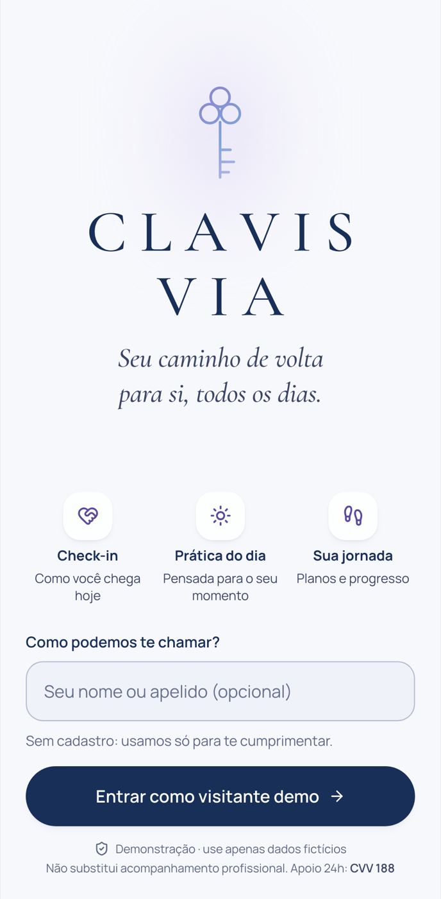
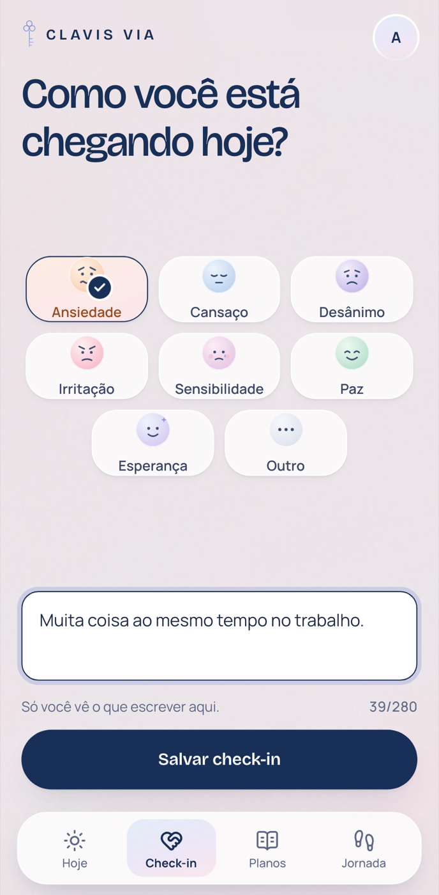
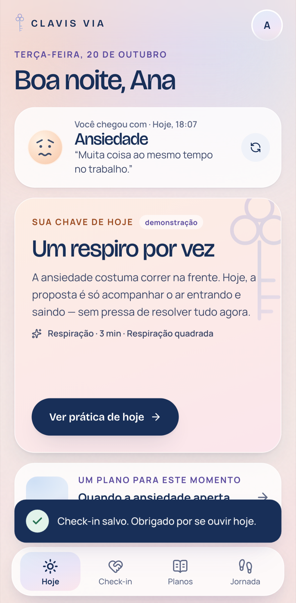
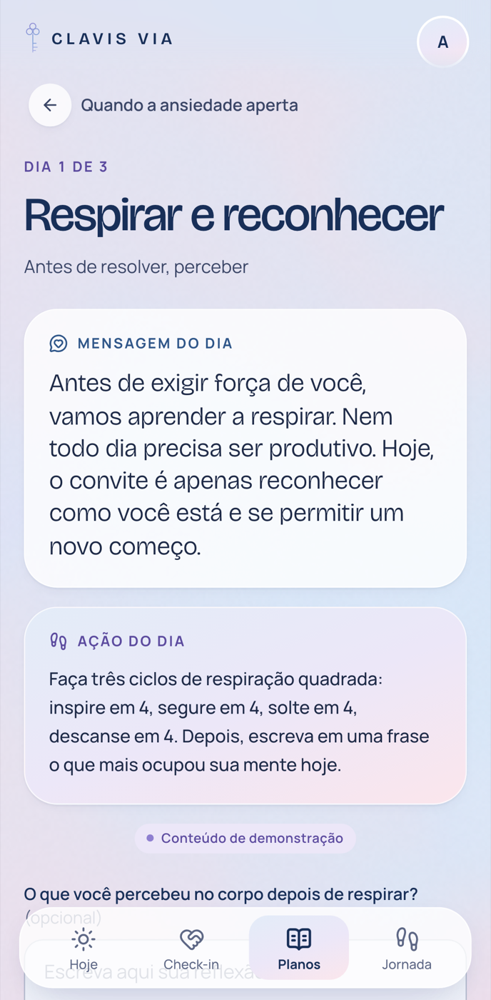
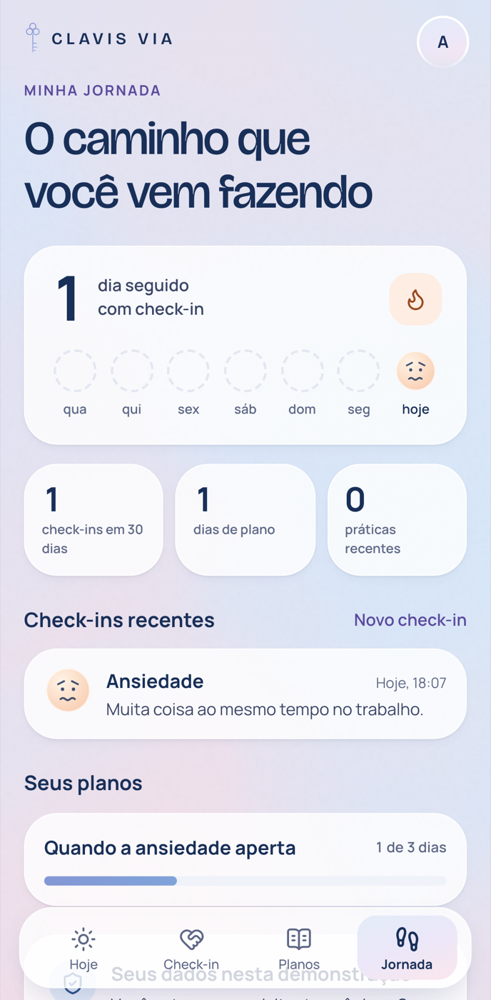
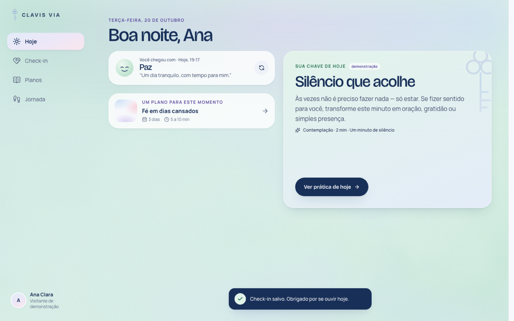
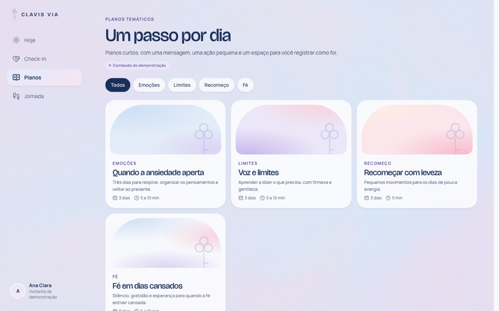
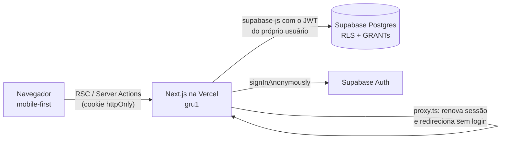

# CLAVIS VIA — protótipo

> Seu caminho de volta para si, todos os dias.

Protótipo **mobile-first** do desafio técnico CLAVIS VIA: a pessoa entra como visitante de demonstração, faz um **check-in emocional**, recebe uma **reflexão e uma prática do dia** coerentes com o que sente, conclui o **Dia 1 de um plano** e acompanha tudo em **Minha Jornada**. Check-ins, práticas e progresso ficam **salvos de verdade** no Postgres (Supabase), isolados por usuário com Row Level Security.

**Demo:** https://clavis-via.vercel.app
**Decisões técnicas (as 7 perguntas):** [DECISOES.md](DECISOES.md) · **Segurança e privacidade:** [docs/seguranca.md](docs/seguranca.md) · **Guia do repositório:** [AGENTS.md](AGENTS.md)

> Todo o conteúdo (práticas, planos, textos) é fictício e foi escrito para a demonstração. O app não oferece diagnóstico, terapia nem aconselhamento profissional.

<p align="center">
  
  
  
  
  
</p>

<p align="center">
  
  
</p>

---

## Roteiro da demonstração (≈ 2 minutos)

Abra no celular ou no modo responsivo do navegador (≈ 390 px).

1. **Entrada** → digite um nome (opcional) → **Entrar como visitante demo**. Cada navegador vira um visitante próprio, sem cadastro.
2. **Check-in** → escolha **Ansiedade** (ou outra emoção), escreva uma nota se quiser → **Salvar check-in**. Pode repetir no mesmo dia: para o Hoje e para a sequência, vale o último.
3. **Hoje** → aparece "Você chegou com Ansiedade", a **chave do dia** e a prática recomendada para essa emoção (ex.: *Respiração quadrada*, com respiração guiada animada). Troque a emoção num novo check-in e veja a recomendação mudar.
4. **Planos** → abra **Voz e limites** → **Começar plano** → escreva uma reflexão (opcional) → **Concluir dia 1**.
5. **Jornada** → o check-in, a nota e o progresso do plano (1 de 3 dias) aparecem.
6. **Atualize a página (F5)** → tudo continua lá.

Extras: o Dia 2 só abre depois do Dia 1 (sem prazo: o Dia 3 abre quando você voltar), **Reiniciar demo** apaga seus registros numa transação e **Sair** apaga a conta do visitante com tudo que ela registrou. Os dois pedem confirmação. O app precisa de conexão (PWA e lembretes estão no plano).

## O que é real e o que é simulado

| Real | Simulado / demonstração |
|---|---|
| Sessão por visitante (usuário **anônimo** do Supabase Auth, cookie `httpOnly` de 30 dias) | Não há cadastro com e-mail/senha. O visitante vive no cookie deste navegador: perder o cookie (outro aparelho, limpar dados) é perder a jornada; **Sair** apaga a conta e tudo que ela registrou. Contas reais estão no plano (DECISOES §5) |
| Check-ins, práticas concluídas, inscrições e dias concluídos gravados no Postgres | Textos das práticas e planos (fictícios, marcados como demonstração) |
| Isolamento entre usuários por RLS + GRANTs por coluna (testado) | — |
| Recomendação por emoção (regra determinística, testada) | Não há IA nem chat. Ficou de fora de propósito (ver DECISOES.md) |
| Regra de dias sequenciais garantida também no banco (trigger) | — |

## Stack

| Camada | Escolha |
|---|---|
| Front-end + back-end | **Next.js 16** (App Router, React Server Components, Server Actions), React 19.3, TypeScript |
| Estilo e movimento | Tailwind CSS v4, **GSAP 3.15** (SplitText, DrawSVG, CustomEase), **Motion** (motion/react), View Transitions nativas do React, fundo em **WebGL** (shader próprio, sem three.js) |
| Dados e auth | **Supabase** (Postgres 17 + Auth anônimo + Data API) em São Paulo (`gru1`), provisionado pela integração da Vercel |
| Validação | Zod (as mesmas regras no formulário e na Server Action) + `CHECK`s no banco |
| Testes | Vitest (unitários + integração de RLS), Playwright (E2E mobile e desktop) + axe-core |
| Deploy | Vercel (funções em `gru1`), deploy automático a cada push na `main` |

## Arquitetura em uma imagem



O navegador **nunca** fala direto com o banco: toda leitura e escrita passa pelo servidor Next (DAL em `src/lib/dal`), que usa o JWT do usuário. Assim, o próprio Postgres aplica o RLS. Não há chave secreta (service role) no app.

## Estrutura

```
src/
  proxy.ts                     # (antigo middleware) renova a sessão e redireciona quem não tem login
  app/
    page.tsx, intro.tsx, enter-demo-form.tsx   # Entrada (abertura animada + entrar como demo)
    actions.ts                                 # entrar como demo / sair (apaga a conta do visitante)
    auth/reset/route.ts                        # encerra uma sessão órfã (cookie válido sem perfil)
    api/health/route.ts                        # health check para monitoramento
    (app)/                                     # área autenticada: cabeçalho no celular, barra lateral no tablet/desktop
      layout.tsx, error.tsx
      check-in/                                # tela + actions.ts + loading.tsx
      hoje/            hoje/pratica/[slug]/    # painel do dia e a prática (respiração guiada)
      planos/          planos/[slug]/          planos/[slug]/dia/[day]/
      jornada/
  components/
    ui/          # Button, Field, FormMessage, ProgressBar, ConfirmDialog, FlashToast, Card, esqueleto
    motion/      # RevealHeading (SplitText), Reveal/Stagger (Motion), PageTransition (View Transitions), CountUp
    emotions/    # rostos SVG, seletor acessível, tons por emoção
    ambient/     # fundo vivo em WebGL (shader próprio) + paletas por emoção
    brand/ nav/  # chave, logo, navegação única (pílula no celular, barra lateral no tablet/desktop)
  lib/
    domain/      # regras puras e testadas: emoções, datas (fuso SP), recomendação, progresso, validação
    dal/         # Data Access Layer (server-only): sessão + consultas
    supabase/    # client SSR, proxy, env e flags de cookie, tipos gerados do banco
    actions/     # estado dos formulários e log sem dados pessoais
supabase/
  migrations/    # schema + RLS, conteúdo de demonstração, GRANTs, exclusão de conta e reset
  config.toml    # Supabase local (portas 553xx, login anônimo ligado)
scripts/db-env.mjs   # gera o .env.local a partir do Supabase local
tests/
  unit/          # domínio e validação
  integration/   # RLS: visitantes reais tentando ler/alterar dados um do outro; exclusão e reset
  e2e/           # fluxo do desafio, validações, navegação, sessão/cookies, aparelhos, tablet/desktop, axe
```

## Rodando localmente

Pré-requisitos: **Node 22.12+** (o projeto usa 24, ver `.nvmrc`), **pnpm 9**, **Docker** (Docker Desktop, Colima ou OrbStack).

```bash
pnpm install
```

```bash
pnpm db:start
```

Isso sobe o Supabase local (Postgres, Auth e API) e aplica as migrations, incluindo o conteúdo de demonstração.

```bash
pnpm db:env
```

Isso escreve o `.env.local` com a URL e a chave do Supabase local (o `.env.example` mostra o formato).

```bash
pnpm dev
```

Abra http://localhost:3000. O Studio do banco fica em http://127.0.0.1:55323.

> As portas do Supabase local são 553xx (e não as 543xx padrão) para não colidir com outros projetos Supabase na mesma máquina.

### Variáveis de ambiente

| Variável | Onde | Descrição |
|---|---|---|
| `NEXT_PUBLIC_SUPABASE_URL` | navegador e servidor | URL da API do Supabase |
| `NEXT_PUBLIC_SUPABASE_PUBLISHABLE_KEY` | navegador e servidor | Chave **publishable** (pública por design). Quem protege os dados é o RLS |

Em produção elas vêm da integração Supabase da Vercel. Nenhum segredo é usado pelo app nem fica no repositório.

### Banco, migrations e seed

- `supabase/migrations/*_init_schema.sql`: tabelas, constraints, trigger de dias sequenciais e RLS
- `supabase/migrations/*_seed_content.sql`: 11 práticas e 4 planos de 3 dias (idempotente, via upsert)
- `supabase/migrations/*_harden_grants.sql`: revoga a exposição automática da Data API e reconcede só o necessário
- `supabase/migrations/*_account_deletion_and_function_grants.sql`: `delete_my_account()` (Sair), `reset_my_demo()` (Reiniciar demo numa transação), `EXECUTE` revogado por padrão e job diário de limpeza de visitantes inativos
- `pnpm db:reset` recria o banco local do zero e `pnpm db:types` regenera os tipos TypeScript
- Produção: `supabase db push --db-url "$POSTGRES_URL_NON_POOLING"` (a URL vem de `vercel env pull`, usada só na hora e apagada depois)

## Testes

```bash
pnpm test:all
```

Roda typecheck, lint, unitários, integração e E2E. Os de integração e E2E precisam do `pnpm db:start`.

| Suíte | Comando | O que cobre |
|---|---|---|
| Unitários (63) | `pnpm test` | Recomendação por emoção (varia com o check-in, determinística por dia), progresso e dias sequenciais, sequência de dias com check-in, datas no fuso de São Paulo (23h30 ≠ dia seguinte), validação com texto vazio, só espaços, no limite, acima do limite, HTML, emoji |
| Integração (18) | `pnpm test:integration` | Visitantes reais no Supabase local: um não lê, não cria em nome do outro, não apaga nem edita dados do outro (em todas as tabelas pessoais); CHECKs do banco; trigger de sequência; FK composta; papel sem sessão sem acesso a tabelas nem a funções; `reset_my_demo` e `delete_my_account` apagando só o que é de quem chama |
| E2E (54 mobile + 51 desktop) | `pnpm test:e2e` | Os **6 passos do desafio com F5**; erros ao enviar vazio; nome/nota/reflexão curtos e longos (contadores e limites); "Outro" exige descrição; HTML exibido como texto; clique duplo não duplica; teclado no seletor; todos os botões da navegação, voltar, filtros, dias bloqueados, 404; **matriz de 5 aparelhos** (telas curtas sem scroll, telas longas sem nada atrás do menu); **tablet/desktop** em 4 tamanhos (barra lateral, grades, sem estouro); respiração guiada (o círculo cresce ao inspirar); reiniciar/sair com cancelar/Esc; isolamento entre dois navegadores; nenhuma tela estoura 320 px; **axe** sem violações graves |

O CI (GitHub Actions) roda tudo a cada push: um job de tipos, lint e unitários, e outro que sobe o Supabase local em Docker para a integração e o E2E em build de produção.

## Deploy

- **Vercel**: projeto conectado ao repositório. Cada push na `main` publica em produção e cada PR ganha uma URL de preview. As funções rodam em `gru1` (São Paulo), na mesma região do banco.
- **Supabase**: provisionado pelo Marketplace da Vercel (as variáveis são sincronizadas automaticamente). Na criação foi preciso ligar *Allow anonymous sign-ins* em Authentication → Sign In / Providers.
- **Saúde**: `GET /api/health` responde se o app e a Auth do Supabase estão de pé (para monitor de uptime).

## Responsividade (mobile-first)

As medidas consideram a **altura visível no navegador**, já sem as barras do Safari e do Chrome. Num iPhone SE isso dá ~553px, não os 667px da tela.

- **Telas de um gesto cabem inteiras, sem scroll**: Entrada, Check-in, Hoje, dia bloqueado e 404. Tamanhos de fonte, ícones, campos e botões são fluidos pela altura (`clamp(min, X·dvh, max)`). A grade de emoções preenche o espaço livre, e em telas baixas detalhes secundários são recolhidos ou encurtados. Ex.: a nota do check-in vira "＋ Adicionar uma nota".
- **Telas longas de verdade rolam** (planos, detalhe do plano, dia, jornada, prática com respiração), com o menu fixo embaixo e nada escondido atrás dele.
- Abaixo de ~540px de altura (celular deitado) as telas encaixadas voltam a rolar, em vez de esmagar o conteúdo. Em tablet e desktop elas param de esticar a partir de ~680px de área útil.
- Tudo isso é verificado por `tests/e2e/responsivo.spec.ts` em: iPhone SE (Safari) 375×553, Android pequeno 360×640, iPhone 14 (Safari) 390×664, iPhone Pro Max (Safari) 430×740 e Pixel 7 412×839.

**Tablet e desktop** (a partir de 768px) deixam de ser uma coluna de celular centralizada:
- A navegação inferior vira **barra lateral**: estreita com ícones no tablet (96px) e completa no desktop (256px, com logo, rótulos e avatar). É o mesmo elemento do celular, só muda de forma, então a pílula ativa continua deslizando entre os itens.
- O conteúdo ganha largura (760px no tablet, 1080px no desktop) e **grades por tela**: Entrada em duas colunas (marca à esquerda, formulário num card de vidro), Check-in com a grade 4×2, Hoje com a chave do dia em destaque à direita, prática com o círculo de respiração fixo ao lado dos passos, planos em cards de 2–3 colunas com capa em arco, plano e dia em duas colunas, Jornada em 3 colunas.
- Verificado por `tests/e2e/layout-grande.spec.ts` em 768×1024, 1024×768, 1280×800 e 1440×900: barra lateral encostada, sem cabeçalho de celular, conteúdo ao lado da barra e nenhuma tela com rolagem horizontal.

## Design: fundo vivo, tipografia e referências

A direção visual veio de uma pesquisa em sites premiados no **Awwwards** (2025–2026). O relatório completo, com 12 referências reais, o que cada uma faz e o que foi aproveitado, está em [docs/referencias-awwwards.md](docs/referencias-awwwards.md).

**Sistema de fundo "seda + grão + luz"** (três camadas fixas atrás do conteúdo):
1. **Aurora WebGL** (`src/components/ambient`): um shader de ~60 linhas (ruído fractal com *domain warping*, como no Why Zero, SOTM set/2026, e no gradiente líquido do Vibrant Wellness, SOTD fev/2026) mistura quatro cores da paleta. Roda a 0,4× da resolução e 30 fps, pausa com a aba oculta e, com "reduzir movimento", fica parado (só as cores transitam). Em aparelhos fracos ou com economia de dados o canvas nem é criado, mas essa detecção (`deviceMemory`, `Save-Data`) só existe no Chromium; no Safari a mitigação é a resolução baixa e os 30 fps. Sem WebGL, o fundo CSS por baixo continua.
2. **Grão** (`.grain` em `globals.css`): SVG `feTurbulence` em *data URI*, estático, em `soft-light`, como no Heron AI (SOTD out/2026) e no Sleep Well Creative (SOTD jan/2026). Tira o aspecto chapado e evita *banding* nos pastéis.
3. **Uma luz por tela**, em vez de blobs espalhados: a fechadura de vidro com halo na Entrada (arco como no Antara Spa e no Sleep Well), a faixa de horizonte tingida pela emoção no Hoje (Bevel Health, HM mai/2026) e o brilho que respira junto com o círculo na prática guiada.

O fundo **reage ao app**: no Check-in ele muda para o tom da emoção escolhida (ao vivo), no Hoje mantém o tom do check-in do dia e na respiração clareia ao inspirar. A API é `useAmbient()` / `<AmbientTone>` em `src/components/ambient/ambient-provider.tsx`.

**Tipografia:** [Bricolage Grotesque](https://fonts.google.com/specimen/Bricolage+Grotesque) (variável, com eixo óptico) nos títulos e botões, e Manrope no texto. Escolhida entre quatro direções testadas lado a lado em telas do app ([docs/previa-fontes.png](docs/previa-fontes.png)). A Cormorant Garamond anterior tinha algarismos *oldstyle* ("1" parecia "I").

## Movimento e acessibilidade

O desafio aceita "componentes simples, sem animações elaboradas" como simplificação. Aqui o movimento é **calmo e funcional**: pouco deslocamento, poucas curvas reutilizadas, saídas mais rápidas que entradas. Ele serve para comunicar o que mudou (erro, salvamento, navegação para frente/para trás) sem atrasar o fluxo. Com **"reduzir movimento"** ativo no sistema, os deslocamentos viram crossfades curtos. Os títulos usam SplitText sem quebrar a leitura por leitores de tela, o seletor de emoções é um `radiogroup` navegável por setas e os erros são anunciados (`aria-live`).

## Limites conhecidos (o que não medi)

Dizer o que falta é parte da entrega:
- **Desempenho do fundo WebGL** foi medido só em desktop (30 fps, sem tarefas longas) e no emulador do Playwright; não em um Android intermediário real. As alavancas de custo (resolução 0,4×, 30 fps, pausa, fallback CSS) existem, mas o número de ms por quadro no aparelho não.
- **Peso de JavaScript**: a Entrada carrega ~0,98 MB de JS sem compressão (14 chunks; GSAP, Motion e Next somados). Se precisasse cortar, começaria trocando o SplitText por uma revelação em CSS e carregando o GSAP só na Entrada e na prática.
- **Detecção de aparelho fraco** só funciona no Chromium (ver acima).
- **Acessibilidade**: verificada com axe e navegação por teclado, não com um leitor de tela real nem com pessoas.
- **CSP** ainda não existe (ver [docs/seguranca.md](docs/seguranca.md)); CAPTCHA no login anônimo também não.
- **Aritmética dos E2E**: o Playwright lista mais casos do que executa por projeto, porque a matriz de aparelhos pula no desktop e os tamanhos grandes pulam no mobile; os números da tabela acima são os executados.

## Uso de IA e recursos externos

Ferramentas usadas: **Claude Code** como par de programação em todas as etapas, com os modelos **Claude Opus 5.5** e **Claude Fable 5.1** (o trailer `Co-Authored-By` de cada commit diz qual), e o boilerplate oficial `create-next-app`.

| Etapa | Como a IA ajudou |
|---|---|
| Entendimento | Extração do enunciado e da imagem de referência do `.docx`; checklist de requisitos |
| Pesquisa visual | Duas rodadas no Awwwards: os *Sites of the Month* (out/2024 → set/2026) para paleta, contraste WCAG e curvas de animação; depois 12 premiados de 2025–2026 lidos ao vivo (código e CSS) para fundos, efeitos e fontes ([docs/referencias-awwwards.md](docs/referencias-awwwards.md)). A fonte final foi escolhida pelo Gustavo numa prévia lado a lado |
| Código | Schema/RLS, domínio, DAL, Server Actions, componentes e telas, gerados e iterados em conversa |
| Testes | Escrita das suítes; a IA também rodou os testes e corrigiu o que falhou (ex.: trigger respondendo com o erro errado, `tailwind-merge` descartando a classe da fonte, aria proibido no SplitText) |
| Segurança | Ao verificar a nuvem, a auditoria encontrou GRANTs automáticos para `anon`, o que gerou a migration `harden_grants` |

**O que foi decidido e validado por mim (Gustavo), sem IA:**
- As escolhas de produto e de stack: Supabase com Postgres (em vez de Neon), um visitante anônimo por navegador com o botão "Entrar como demo" (em vez de uma única usuária seedada), testes unitários + E2E + CI com casos de uso reais (campos curtos e longos, envio vazio, todos os botões), e a diretriz de que nada na interface "pisca": todo estado tem transição.
- A direção visual: pedi que as referências viessem de sites premiados no Awwwards e escolhi a Bricolage Grotesque entre quatro opções numa prévia lado a lado; recusei a fonte inicial (Cormorant Garamond) e os fundos chapados da primeira versão.
- Escopo e tom: tirei da Entrada o aviso sobre apoio psicológico (CVV), por ser uma demonstração; mantive o selo "Conteúdo de demonstração"; pedi que telas de um gesto coubessem na altura do celular sem scroll e, depois, as versões para tablet e desktop.
- Validação: acompanhei as telas no meu próprio navegador e no Supabase (liguei o login anônimo no painel de produção), apontei o que estava fora (fundo seco, fonte, altura das telas) e aprovei cada rodada antes da seguinte.
- O que a IA fez e eu revisei: o código das telas, a camada de dados, as migrations com RLS, os testes e os documentos foram escritos em par com o Claude Code e lidos por mim antes do envio. Os pontos que vou explicar na conversa técnica estão no DECISOES.md.

---

Protótipo destinado exclusivamente à avaliação do processo seletivo.
